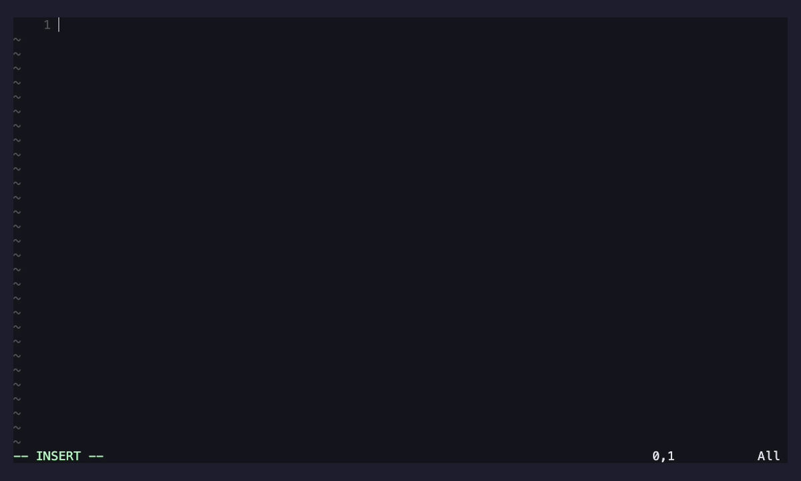
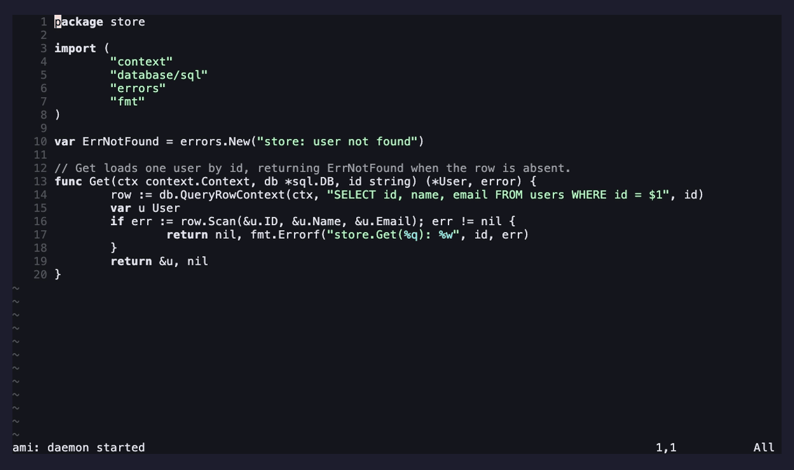
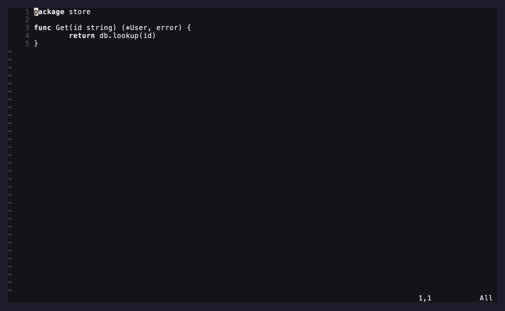
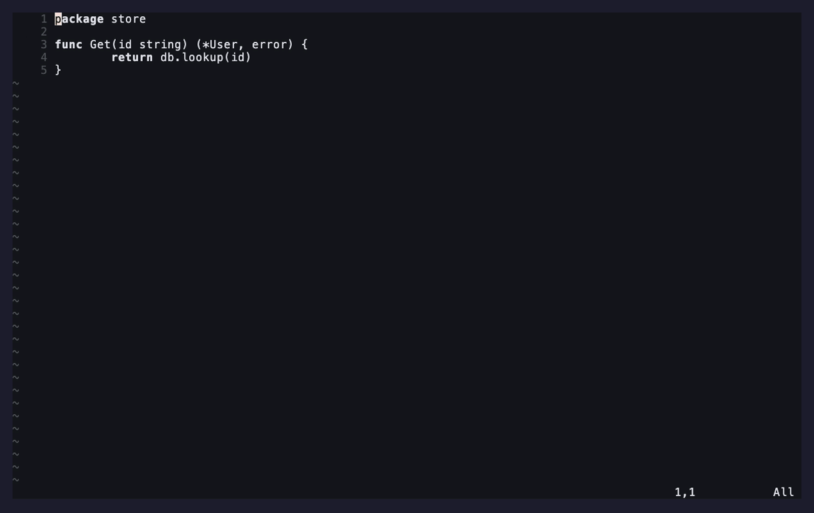
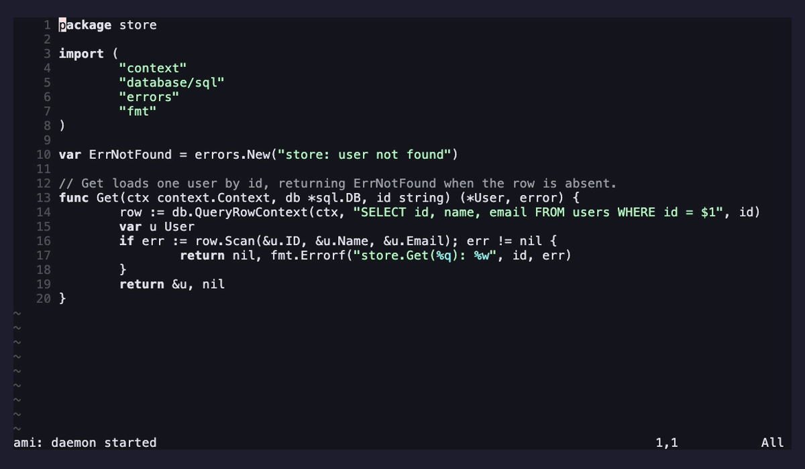

# ami

*ami — "friend" in French.* A pair programmer that sits with you, not ahead of you.

> ⚠️ **Status: early / experimental (v0.2.1).** It works and is covered by tests,
> but it hasn't been battle-tested in day-to-day interactive use — expect sharp
> edges, and pin a commit if you depend on it. Feedback and issues welcome.

An IDE-resident AI pair programmer for Neovim — **advisor, not actor**. It
discusses problems, surfaces trade-offs, completes code inline, and offers the
occasional proactive suggestion, but it **never edits your files**. Built to keep
you in control and in practice, backed entirely by local models via
[LM Studio](https://lmstudio.ai/).

It's a Lua plugin plus a small Go daemon (`amid`). The daemon holds the
intelligence (context assembly, history, LLM proxying, streaming); Neovim stays a
thin client. Everything speaks the OpenAI-compatible API, so it's model-agnostic.

## Features

- **Chat advisor panel** — a floating transcript + prompt. Discuss your thinking
  and get streamed, advice-only feedback grounded in your open file, selection,
  `README.md`/`PLAN.md`, and — via LSP — the files your code depends on.
- **Inline completion** — native Copilot-style FIM ghost text, manual by default
  (or debounced auto). Accept/dismiss; nothing is written until you accept.
- **Branching history tree** — every message is a node; branch from any point and
  switch between branches. Summarize an old branch to shrink context
  non-destructively.
- **Proactive suggestions** — off by default; an occasional unsolicited aside on
  idle or save, rate-limited and never mid-typing.
- **Runtime model selector** — pick the chat and FIM models live from whatever
  LM Studio has loaded.
- **Managed daemon** — started/stopped with Neovim, reference-counted so it's
  shared across instances and stops only when the last one exits.

## Requirements

- Neovim ≥ 0.10 (`vim.system`, `vim.uv`, `vim.fs.root`)
- Go (to build the daemon; auto-built on first run if present)
- `curl` on `PATH`
- [LM Studio](https://lmstudio.ai/) (or any OpenAI-compatible server) with a
  model loaded — a FIM-capable code model (Qwen Coder, DeepSeek-Coder,
  StarCoder2, CodeLlama) is recommended for inline completion
- **Linux** (developed on macOS too; **Windows is not supported** — the daemon is
  launched via `sh` and everything shells out to `curl`)

## Installation

With [lazy.nvim](https://github.com/folke/lazy.nvim):

```lua
{
  "moosch/ami.nvim",
  build = "make build",        -- compiles the Go daemon (amid)
  config = function()
    require("ami").setup({
      -- point inline/daemon at your LM Studio if it isn't on localhost:
      -- chat   = { endpoint = "http://localhost:1234/v1", model = "qwen3-coder" },
      -- inline = { endpoint = "http://localhost:1234/v1", model = "qwen3-coder" },
    })
  end,
}
```

The `build` step compiles `amid`. If you skip it, the plugin auto-builds the
binary on first run when `go` is available.

## Quick start

1. Start LM Studio and load a model (defaults assume `http://localhost:1234/v1`).
2. Open a project in Neovim — `amid` starts automatically.
3. `:AmiChat`, type a question, `<Esc>` then `<Enter>` to send.
4. In insert mode, `<C-g>` requests an inline completion; `<Tab>` accepts it.
5. `:checkhealth ami` if anything looks off.

## Demos

Inline, comment-driven completion — write a comment, trigger, accept:



Chat advisor — discuss a problem, get advice-only feedback:



Conversation tree — summarize history to shrink context:



Conversation tree — branch to explore an alternative:



Runtime model selector — swap chat/FIM models on the fly:



> These GIFs are rendered from [VHS](https://github.com/charmbracelet/vhs) tapes in
> `demos/`. Regenerate them with `make demos` (needs `vhs` and a running LM Studio;
> set `AMI_ENDPOINT` for a non-localhost server). Tune the `Sleep` lines in each
> `.tape` to match your model's latency.

## Commands

| Command | What it does |
| --- | --- |
| `:AmiChat` | Toggle the chat panel (prompt: `<CR>` normal-mode = send, `<C-n>` new session, `q`/`<Esc>` hide) |
| `:AmiAsk {text}` | One-shot question; visual mode sends the selection + its deps |
| `:AmiNewSession [name]` | Start a fresh conversation |
| `:AmiTree` | Conversation tree — branch/switch/summarize |
| `:AmiComplete` | Request an inline completion |
| `:AmiInlineAuto` | Toggle inline auto-trigger |
| `:AmiModel [chat\|fim]` | Select the chat/FIM model at runtime |
| `:AmiModels` | Show current model selections |
| `:AmiProactive` | Toggle proactive suggestions (off by default) |
| `:AmiNudge` | Request a proactive suggestion now |
| `:AmiDaemon [start\|stop\|restart]` | Control the managed daemon |
| `:AmiHealth` / `:AmiLog` / `:AmiDebug` | Status / log viewer / verbose logging |

Default inline insert-mode keys (configurable): `<C-g>` request, `<Tab>` accept
(falls back to a real Tab when none shown), `<C-]>` dismiss.

**Comment-driven completion** works like the original Copilot: write a comment
describing what you want, put the cursor on the line below it, and press `<C-g>` —
the comment is part of the FIM prefix, so the model completes the function. (Code
*after* the cursor is sent as the FIM suffix too, so it fills in context-aware.)
Set `inline.auto = true` for debounced ghost text as you type instead of on
keypress.

## Configuration

Defaults shown; pass overrides to `setup()`:

```lua
require("ami").setup({
  daemon_url = "http://127.0.0.1:8787",
  -- Chat/advisor provider (used via the daemon). Can be a different
  -- provider/model from inline completion below.
  chat = {
    endpoint = "http://localhost:1234/v1",
    model = "qwen3-coder",         -- change live with :AmiModel
  },
  session_dir = nil,               -- nil = stdpath("data")/ami (out of your repos)
                                   --  "" = each project's ./.ami/sessions
  daemon = { auto_start = true, auto_build = true, bin = nil },
  context = { lsp_deps = true, dep_max_files = 5, dep_timeout_ms = 1500, dep_max_positions = 30 },
  inline = {
    enabled = true,
    endpoint = "http://localhost:1234/v1",   -- inline talks here directly (low latency)
    model = "qwen3-coder",
    prewarm = true,                -- load the model on setup so the first completion is fast
    auto = false, debounce_ms = 400,
    max_tokens = 256, max_lines = 0, temperature = 0.2,  -- max_lines 0 = no cap
    context_before_lines = 120, context_after_lines = 60,
    fim = { prefix = "<|fim_prefix|>", suffix = "<|fim_suffix|>", middle = "<|fim_middle|>" },
    keymaps = { trigger = "<C-g>", accept = "<Tab>", dismiss = "<C-]>" },
  },
  proactive = {
    enabled = false, on_idle = true, idle_ms = 20000,
    on_save = true, min_interval_s = 180, require_normal_mode = true, notify = true,
  },
})
```

**Chat and inline are independent providers.** `chat.endpoint`/`chat.model` back
the advisor (through the daemon); `inline.endpoint`/`inline.model` back completion
(direct). Point them at the same LM Studio, or at two different
providers/models entirely.

The FIM tokens default to Qwen's format; set `inline.fim`/`inline.stop` to match
a different model family. For snappy as-you-type completion, a smaller FIM model
(e.g. `deepseek-coder-6.7b-instruct`) is much faster than a 30B chat model, at the
cost of a second model resident in VRAM. `inline.prewarm` loads the FIM model on
setup so your first completion doesn't pay the cold-start cost.

**Inline not appearing?** First, make sure `inline.endpoint` points at your LM
Studio (it defaults to `http://localhost:1234/v1`, so set it if LM Studio runs
elsewhere). Turn on `:AmiDebug`, press `<C-g>`, and check `:AmiLog` — inline now
reports the exact cause (connection refused, timeout, server error). The **first**
completion is often a timeout while LM Studio loads the model into VRAM; it works
once the model is warm. Raise `inline.timeout_ms` or use a smaller FIM model if
cold loads routinely exceed the limit.

The daemon also reads these environment variables (the plugin sets them from the
config above — `AMI_LMSTUDIO_URL`/`AMI_CHAT_MODEL` come from `chat`):
`AMI_ADDR`, `AMI_LMSTUDIO_URL`, `AMI_CHAT_MODEL`, `AMI_CONTEXT_BUDGET`,
`AMI_DATA_DIR`.

## Where history is stored

Conversation history is a branching tree saved under `session_dir`, which
defaults to `stdpath("data")/ami/<project>/sessions/` — **outside your
repositories**, so nothing leaks into your working tree. Set `session_dir = ""`
to instead keep it in each project's own `.ami/sessions/` (add `.ami/` to
your global gitignore if you do).

## How it works

```
Neovim (Lua)  ──HTTP+SSE──▶  amid (Go)  ──OpenAI-compatible──▶  LM Studio
 chat UI, inline,             context, history,                     local models
 events, context  ◀────────  tree, LLM proxy  ◀──────────────────
```

Inline completion talks to LM Studio **directly** (not through the daemon) to
keep latency low. The daemon is reference-counted across Neovim instances via a
registry under `stdpath("state")/ami/`, so one `amid` is shared and only
stopped when the last instance exits.

## Development

```sh
make build   # build bin/amid
make test    # go test ./...
make run     # run the daemon in the foreground
```

The Go daemon lives in `cmd/amid` + `internal/`; the plugin in `lua/ami`.
CI runs `go vet` / `go test` / `go build`.

## License

[MIT](LICENSE)
